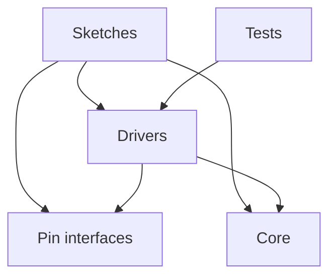

# Architecture

This repository is a monorepo: the firmware and Robomania, its website, live and change together in one history,
and each takes the drivers in `lib/` straight from the working tree, never from a released package. A change to a
driver reaches every sketch and the website's Library page in the same commit.

The drivers in `lib/` are also released as the Robomania Arduino library, a ZIP on the repository's GitHub
Releases, for sketches outside this repository. The Arduino Library Manager indexes a library only when its
`library.properties` sits at the root of its repository, and here the root holds the whole monorepo, so the ZIP is
the one release. The library workflow, `.github/workflows/lib.yaml`, zips `lib/` and tags it `lib-v<version>`, with
the version from `lib/library.properties`, when a push to `main` includes a commit whose message contains
`#lib-release`, or when someone runs it by hand. A version already released fails the run, so each release raises
the version first. The website has its own marker, `#site-release`, so each releases alone.

## Firmware

The firmware has five parts:

- **Sketches**, in `sketches/<name>/`: each is one firmware image, for one robot or for trying one driver on a board.
  A sketch says which device sits on which pin, and holds its robot's control logic.
- **Pin interfaces**, in `lib/`: the kinds of pin output a driver can ask for, such as a level or a PWM signal, each
  with a class per way the ESP32 produces it.
- **Drivers**, in `lib/`: one library that the ESP32 sketches build with. Each driver runs one sort of device, such
  as a motor, a servo or a camera, serves one protocol, or does one control calculation, such as a PID controller.
  The [README](../README.md#code-layout) lists them.
- **Tests**, in `test/`: programs that run the drivers on the developer's machine, with no board. Automated tests
  cover only `lib/`, and of it the drivers that compute without touching hardware. A sketch is checked by compiling
  it and by running it on its board.
- **Core**: the Arduino core that each sketch's `sketch.yaml` pins for its board. The ESP32 sketches pin the
  Bluepad32 ESP32 core, which gives the Arduino API, ESP-IDF and the Bluetooth gamepad stack. `sketches/web-relay`
  pins the ESP8266 core for the ESP-01S, and `sketches/usb-key` the Digistump AVR core for the Digispark; these two
  build without `lib/`.

Dependencies point one way: sketches depend on drivers, pin interfaces and the core, and drivers on pin interfaces
and the core; nothing in `lib/` depends on a sketch or on a test. Drivers reach the hardware only through the pin interfaces, so a
driver runs on any pin that gives the output it needs. A few drivers call ESP-IDF directly and build only for ESP32;
the rest use only the Arduino API, and the ones under test use neither.

A sketch takes the values that differ from one build of its robot to the next, such as a password or a throttle
range, from a `local.h` in its folder. Git ignores the file, so a secret stays out of the history, and a sketch
without one builds with the defaults in its code.

## Website

Robomania, the project's website in `site/`, is an Astro site built apart from the firmware. It depends on `lib/`:
its Library page reads the driver headers at build time, and nothing in the firmware depends on it. It shares
`mise.toml` with the firmware. The publishing workflow, `.github/workflows/site.yaml`, installs Node, pnpm, Python and
arduino-cli from it, builds the firmware images the site flashes with `arduino:firmware`, and caches `.arduino/`.

The workflow publishes a new site version to GitHub Pages, at <https://lmarqs.github.io/robomania/>, when a push to
`main` includes a commit whose message contains `#site-release`, or when someone runs it by hand. Other pushes leave the
published site as it is.
