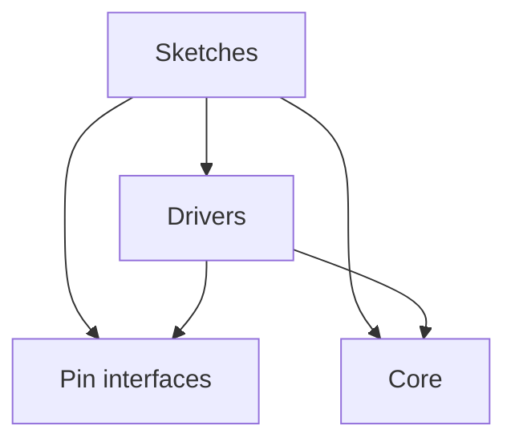

# Architecture

This repository is a monorepo: the firmware and Robomania, its website, live and change together in one history,
and each takes the drivers in `lib/` straight from the working tree, never from a released package. A change to a
driver reaches every sketch and the website's Library page in the same commit.

The drivers in `lib/` are also released as the Robomania Arduino library, a ZIP on the repository's GitHub
Releases, for sketches outside this repository. The Arduino Library Manager indexes a library only when its
`library.properties` sits at the root of its repository, and here the root holds the whole monorepo, so the ZIP is
the one release. The library workflow, `.github/workflows/lib.yaml`, zips `lib/` and tags it `lib-v<version>`, with
the version from `lib/library.properties`, when a push to `main` includes a commit whose message contains
`#lib-release`, or when someone runs it by hand. A version already released fails the run, so each release raises
the version first. The marker differs from the website's `#release` so that each releases alone.

## Firmware

The firmware has four parts:

- **Sketches**, in `sketches/<name>/`: each is one firmware image, for one robot or for trying one driver on a board.
  A sketch says which device sits on which pin, and holds its robot's control logic.
- **Pin interfaces**, in `lib/`: the kinds of pin output a driver can ask for, such as a level or a PWM signal, each
  with a class per way the ESP32 produces it.
- **Drivers**, in `lib/`: one library that every sketch builds with. Each driver runs one sort of device, such as a
  motor, a servo or a camera, or serves one protocol. The [README](../README.md#code-layout) lists them.
- **Core**: the Bluepad32 ESP32 Arduino core that each sketch's `sketch.yaml` pins. It gives the Arduino API,
  ESP-IDF and the Bluetooth gamepad stack.

Dependencies point one way: sketches depend on drivers, pin interfaces and the core, and drivers on pin interfaces
and the core; nothing in `lib/` depends on a sketch. Drivers reach the hardware only through the pin interfaces, so a
driver runs on any pin that gives the output it needs. A few drivers call ESP-IDF directly and build only for ESP32;
the rest use only the Arduino API.

## Website

Robomania, the project's website in `site/`, is an Astro site built apart from the firmware. It depends on `lib/`:
its Library page reads the driver headers at build time, and nothing in the firmware depends on it. It shares
`mise.toml` with the firmware but needs only Node and pnpm from it, so the publishing workflow,
`.github/workflows/site.yaml`, installs only those two and skips the firmware toolchain.

The workflow publishes a new site version to GitHub Pages, at <https://lmarqs.github.io/robomania/>, when a push to
`main` includes a commit whose message contains `#release`, or when someone runs it by hand. Other pushes leave the
published site as it is.
