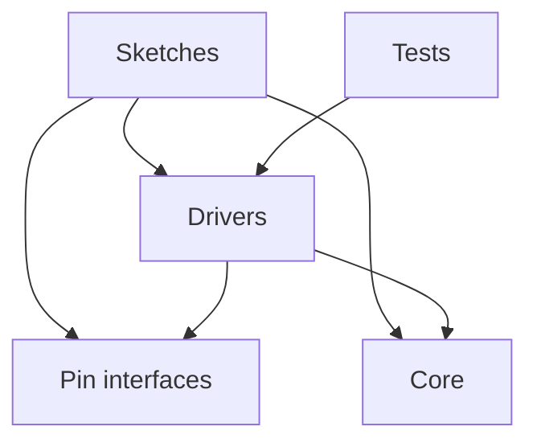
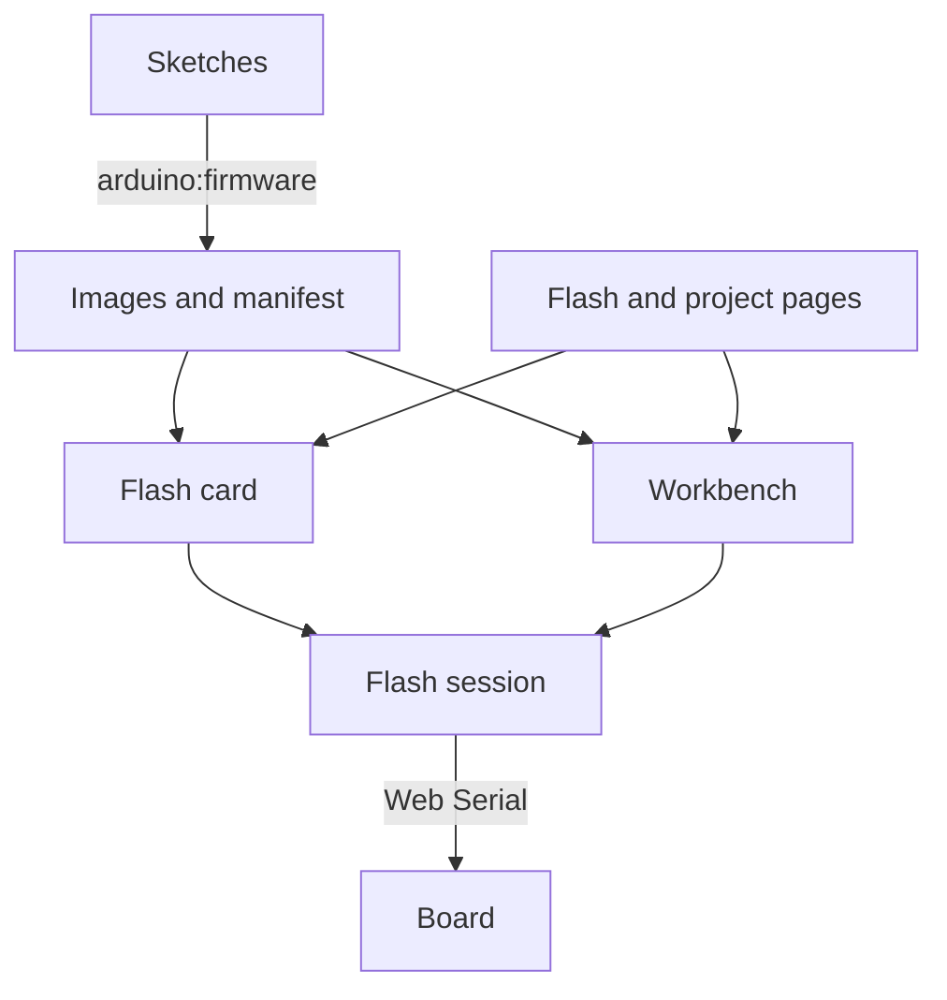

# Architecture

This repository is a monorepo: the firmware and Robomania, its website, live and change together in one history,
and each takes the drivers in `lib/` straight from the working tree, never from a released package. A change to a
driver reaches every sketch and the website's Library page in the same commit.

The drivers in `lib/` are also released as the Robomania Arduino library, a ZIP on the repository's GitHub
Releases, for sketches outside this repository. The Arduino Library Manager indexes a library only when its
`library.properties` sits at the root of its repository, and here the root holds the whole monorepo, so the ZIP is
the one release. The library workflow, `.github/workflows/lib.yaml`, zips `lib/` and tags it `lib-v<version>`, with
the version from `lib/library.properties`, when a push to `main` includes a commit whose message contains
`#lib-release`, or when someone runs it by hand. A version already released fails the run, so each release raises
the version first. The website has its own marker, `#site-release`, so each releases alone. The Library page links
the `lib-v<version>` asset, so a raised version is released before the site.

## Firmware

The firmware has five parts:

- **Sketches**, in `sketches/<name>/` or, to group the variants of a project, `sketches/<project>/<variant>/`: each is
  one firmware image, for one robot or for trying one driver on a board. A sketch is a folder with a `sketch.yaml`;
  a folder without one is searched a level down. A sketch says which device sits on which pin, and holds its robot's
  control logic. Its path under `sketches/` names it in the firmware manifest and its image folder.
- **Pin interfaces**, in `lib/`: the kinds of pin output a driver can ask for, such as a level or a PWM signal, each
  with a class per way the ESP32 produces it.
- **Drivers**, in `lib/`: one library that the ESP32 sketches build with. Each driver runs one sort of device, such
  as a motor, a servo or a camera, serves one protocol, or does one control calculation, such as a PID controller.
  The [README](../README.md#code-layout) lists them.
- **Tests**, in `test/`: programs that run the drivers on the developer's machine, with no board. Automated tests
  cover only `lib/`, and of it the drivers that compute without touching hardware. A sketch is checked by compiling
  it and by running it on its board.
- **Core**: the Arduino core that each sketch's `sketch.yaml` pins for its board. The ESP32 sketches pin the
  Bluepad32 ESP32 core, which gives the Arduino API, ESP-IDF and the Bluetooth gamepad stack. `sketches/web-relay`
  pins the ESP8266 core for the ESP-01S, and `sketches/usb-key` the Digistump AVR core for the Digispark; these two
  build without `lib/`.

Dependencies point one way: sketches depend on drivers, pin interfaces and the core, and drivers on pin interfaces
and the core; nothing in `lib/` depends on a sketch or on a test. Drivers reach the hardware only through the pin interfaces, so a
driver runs on any pin that gives the output it needs. A few drivers call ESP-IDF directly and build only for ESP32;
the rest use only the Arduino API, and the ones under test use neither.

A sketch takes the values that differ from one build of its robot to the next, such as a password or a throttle
range, from a `local.h` in its folder. Git ignores the file, so a secret stays out of the history, and a sketch
without one builds with the defaults in its code.

A sketch can also store such values on the board, sent over its serial port with `cfg set`. A value stored this way
overrides the one in `local.h`, which overrides the default in the sketch's code. The sketch's page in
[Sketches](sketches/README.md) lists its keys, and its `settings.json` lists them for the website, as the
[Website](#website) section says.

## Website

Robomania, the project's website in `site/`, is an Astro site built apart from the firmware. It depends on `lib/`:
its Library page reads the driver headers at build time, and nothing in the firmware depends on it. It shares
`mise.toml` with the firmware. The publishing workflow, `.github/workflows/site.yaml`, installs Node, pnpm, Python and
arduino-cli from it, builds the firmware images the site flashes with `arduino:firmware`, and caches `.arduino/`.

The site also puts the firmware on a board. Its parts:

- **Images**: `arduino:firmware` compiles every sketch profile that targets an ESP chip and copies the parts of each
  image, with their offsets, into `site/public/firmware/`, which Git ignores. It writes `manifest.json` beside them:
  per sketch, its images by profile and chip family, and the fields of the sketch's `settings.json` when it has one.
  It refuses a sketch that has a `local.h`, whose secrets would ship to every visitor.
- **Settings list**: a sketch that stores values over `cfg` has a `settings.json` in its folder, one entry per value
  with its `cfg` key, label, type, default and limits, which are the sketch's own or stricter. `arduino:firmware`
  rejects an entry the card cannot show.
- **Flash slice**: `site/src/lib/flash/` holds the logic and `site/src/components/flash/` the card. The logic reads
  the manifest, talks to the board over Web Serial and walks one session through connecting, the settings form,
  flashing and running. The rest of the site imports the card, `FlashCard`, the manifest reader, and
  `site/src/lib/flash/index.ts`, which gives the workbench the session, `createFlasher` and the wording the card
  and the workbench share.
- **Pages**: the `/flash/` page lists the projects that have an image and shows the card of the one picked; each
  project page with a sketch shows the same card above its text, except a page with a workbench, whose Board cell
  connects to the board and flashes the selected step. A project page keeps its own section on building
  and flashing the sketch with the tools.

The card reads the manifest at build time and flashes in the visitor's browser, which Chrome and Edge allow on a
computer. It picks the image for the chip it finds on the port. For a sketch with settings and a baud, it asks for the
values first, flashes the board, and once the board has reset reads its serial output at the sketch's baud. It sends
`cfg get` until the board lists its values, `cfg set` for each one that differs, and `cfg restart` so the new values
take effect. A sketch with no baud prints nothing, so its card flashes without settings. The session also serves a
workbench that shares one connection for control and flashing: `connect` with `reset` restarts the board without
flashing, `subscribeLines` delivers every line the board prints with its arrival time, `sendLine` writes a line, and
the `flash` event flashes a manifest key on the open port and keeps reading. Once the board names the selected step,
the workbench follows it: the board pane is drawn from the lines the board prints, and what the visitor sends goes
to the board. Pause, Step or Restart hands the pane back to the simulator with the port still open. The tests, in `site/tests`,
run the card in a browser against a fake serial port.

The workflow publishes a new site version to GitHub Pages, at <https://lmarqs.github.io/robomania/>, when a push to
`main` includes a commit whose message contains `#site-release`, or when someone runs it by hand. Other pushes leave the
published site as it is.
