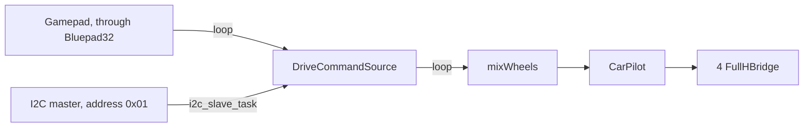

# Architecture

Each sketch in `sketches/` is one firmware image: arduino-cli builds it with every source in `lib/` and with the
Bluepad32 ESP32 core that its `sketch.yaml` pins. The [README](../README.md#code-layout) lists the drivers.

## Pins and the drivers on them

`lib/pin.h` declares the interfaces drivers take their pins through: `InPin` and `OutPin` for levels, and `PwmOutPin`
for a square wave whose duty runs from 0 to `PwmOutPin::DUTY_MAX`.

| Interface | Pin classes |
| --- | --- |
| `InPin` | `DigitalInPin` in `digital_pin.*`, `AnalogInPin` in `analog_pin.*` |
| `OutPin` | `DigitalOutPin` in `digital_pin.*`, `AnalogOutPin` in `analog_pin.*` |
| `PwmOutPin` | `EspLedcOutPin` in `ledc_pin.*` |

Drivers depend on the interfaces, never on a pin class: `FullHBridge` takes one `PwmOutPin` and two `OutPin`s,
`HalfHBridge` two `PwmOutPin`s, and each `Servo` one `PwmOutPin`. A sketch picks the pin classes and passes them in,
as `sketches/servo/servo.ino` does.

`camera*`, `ledc_pin.*` and `web_server.*` call ESP-IDF and build only for ESP32; the other drivers use only the
Arduino API.

## The LEDC allocator

`lib/ledc_pin.cpp` keeps the record of which LEDC channels and timers are taken. Each `EspLedcOutPin` takes a channel
in `begin()`, and `EspCamera::begin()` reserves a whole timer for the camera's clock with `ledcReserveTimer()`,
releasing it when the camera fails to start. `analogWrite()` takes channels from the other end without telling the
allocator, so the two meet only when the channels run out.

## The omnidirectional sketch

`sketches/omnidirectional` drives four wheels from two sticks: the left stick turns the robot, the right moves it.

- `drive_command.*` holds the latest command from each origin. The gamepad's wins while it is fresh, then the I2C
  master's; a command older than 500 ms counts as none, and the motors stop.
- The I2C callback runs in the core's own task, so it only stores its command; `loop()` is the only code that
  writes the motors.
- `wheel_mixer.*` turns the two sticks into four signed wheel speeds, with no Arduino or motor type in between.
- `car.h` holds the pin map and `CarPilot`, which turns each speed into a duty of up to 80% of `DUTY_MAX`.
