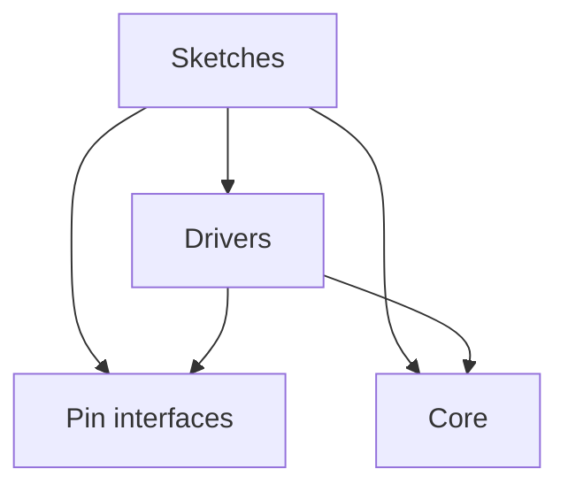

# Architecture

The firmware has three parts:

- **Sketches**, in `sketches/<name>/`: each is one firmware image, for one robot or for trying one driver on a board.
  A sketch says which device sits on which pin, and holds its robot's control logic.
- **Drivers**, in `lib/`: one library that every sketch builds with. Each driver runs one sort of device, such as a
  motor, a servo or a camera, or serves one protocol. The [README](../README.md#code-layout) lists them.
- **Core**: the Bluepad32 ESP32 Arduino core that each sketch's `sketch.yaml` pins. It gives the Arduino API,
  ESP-IDF and the Bluetooth gamepad stack.

Dependencies point one way, from sketches to drivers to the core. Drivers reach the hardware only through the pin
interfaces in `lib/`, so a driver runs on any pin that gives the output it needs, and the sketch picks the pin. A few
drivers call ESP-IDF directly and build only for ESP32; the rest use only the Arduino API.
