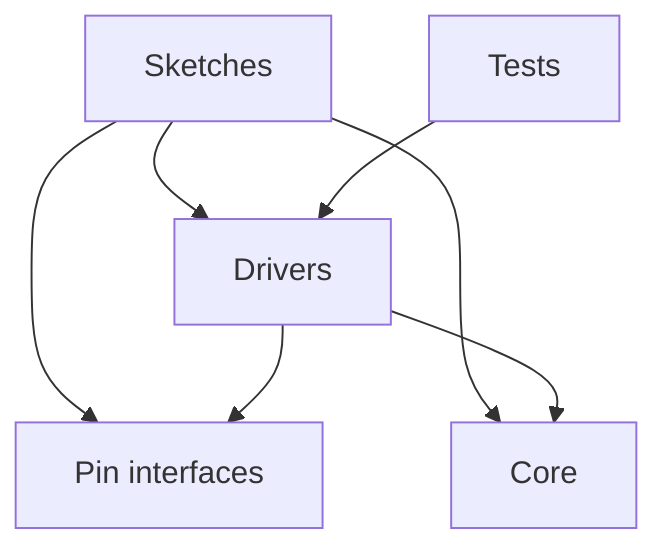
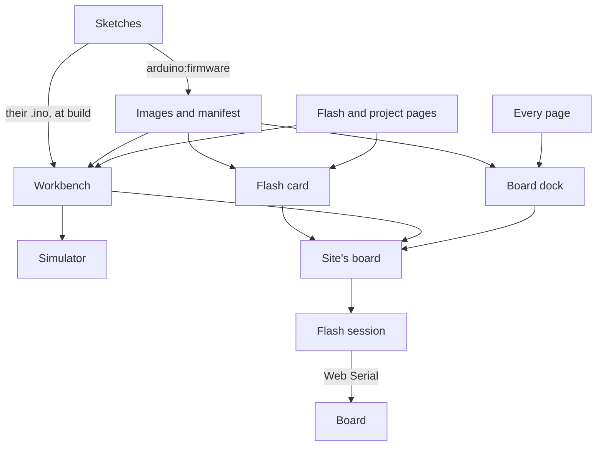

# Architecture

This repository is a monorepo: the firmware and Robomania, its website, live and change together in one history,
and each takes the drivers in `lib/` straight from the working tree, never from a released package. A change to a
driver reaches every sketch and the website's Library page in the same commit.

The drivers in `lib/` are also released as the Robomania Arduino library, a ZIP on the repository's GitHub
Releases, for sketches outside this repository. The Arduino Library Manager indexes a library only when its
`library.properties` sits at the root of its repository, and here the root holds the whole monorepo, so the ZIP is
the one release. The library workflow, `.github/workflows/lib.yaml`, zips `lib/` and tags it `lib-v<version>`, with
the version from `lib/library.properties`, when a push to `main` includes a commit whose message contains
`#lib-release`, or when someone runs it by hand. A version already released fails the run, so each release raises
the version first. The website has its own marker, `#site-release`, so each releases alone. The Library page links
the `lib-v<version>` asset, so a raised version is released before the site.

## Firmware

The firmware has five parts:

- **Sketches**, in `sketches/<name>/` or, to group the variants of a project, `sketches/<project>/<variant>/`: each is
  one firmware image, for one robot or for trying one driver on a board. A sketch is a folder with a `sketch.yaml`;
  a folder without one is searched a level down. A sketch says which device sits on which pin, and holds its robot's
  control logic. Its path under `sketches/` names it in the firmware manifest and its image folder.
- **Pin interfaces**, in `lib/`: the kinds of pin output a driver can ask for, such as a level or a PWM signal, each
  with a class per way the ESP32 produces it.
- **Drivers**, in `lib/`: one library that the ESP sketches build with. Each driver runs one sort of device, such
  as a motor, a servo or a camera, serves one protocol, or does one control calculation, such as a PID controller.
  The [README](../README.md#code-layout) lists them.
- **Tests**, in `test/`: programs that run the drivers on the developer's machine, with no board. Automated tests
  cover only `lib/`, and of it the drivers that compute without touching hardware. A sketch is checked by compiling
  it and by running it on its board.
- **Core**: the Arduino core that each sketch's `sketch.yaml` pins for its board. The ESP32 sketches pin the
  Bluepad32 ESP32 core, which gives the Arduino API, ESP-IDF and the Bluetooth gamepad stack. `sketches/web-relay`
  pins the ESP8266 core for the ESP-01S, and `sketches/usb-key` the Digistump AVR core for the Digispark, which builds
  without `lib/`.

Dependencies point one way: sketches depend on drivers, pin interfaces and the core, and drivers on pin interfaces and
the core; nothing in `lib/` depends on a sketch or on a test. Drivers reach the hardware only through the pin
interfaces, so a driver runs on any pin that gives the output it needs. A few drivers call ESP-IDF directly and build
only for ESP32; the rest use only the Arduino API, and the ones under test use neither.

A sketch takes the values that differ from one build of its robot to the next, such as a password or a throttle
range, from a `local.h` in its folder. Git ignores the file, so a secret stays out of the history, and a sketch
without one builds with the defaults in its code.

A sketch can also store such values on the board, sent over its serial port with `cfg set`. A value stored this way
overrides the one in `local.h`, which overrides the default in the sketch's code. The sketch's page in
[Sketches](sketches/README.md) lists its keys, and its `settings.json` lists them for the website, as the
[Website](#website) section says.

## Website

Robomania, the project's website in `site/`, is an Astro site built apart from the firmware. It depends on `lib/`:
its Library page reads the driver headers at build time, and nothing in the firmware depends on it. It shares
`mise.toml` with the firmware. The publishing workflow, `.github/workflows/site.yaml`, installs Node, pnpm, Python and
arduino-cli from it, builds the firmware images the site flashes with `arduino:firmware`, and caches `.arduino/`.

The site also puts the firmware on a board. Its parts:

- **Images**: `arduino:firmware` compiles every sketch profile that targets an ESP chip and copies the parts of each
  image, with their offsets, into `site/public/firmware/`, which Git ignores. It writes `manifest.json` beside them:
  per sketch, its images by profile and chip family, and the fields of the sketch's `settings.json` when it has one.
  It refuses a sketch that has a `local.h`, whose secrets would ship to every visitor.
- **Settings list**: a sketch that stores values over `cfg` has a `settings.json` in its folder, one entry per value
  with its `cfg` key, label, type, default and limits, which are the sketch's own or stricter. `arduino:firmware`
  rejects an entry the card cannot show.
- **Flash slice**: `site/src/lib/flash/` holds the logic and `site/src/components/flash/` the card. The logic reads
  the manifest, talks to the board over Web Serial and walks one session through connecting, the settings form,
  flashing and running. The rest of the site takes from the slice the card, the manifest and its reader, and a
  public module, `site/src/lib/flash/index.ts`, that gives the board slice the session and the flasher, and the
  workbench the wording the card and the workbench share.
- **Board slice**: `site/src/lib/board/` holds the visitor's board, one for the whole site: the flash session that
  holds its port, which page owns it, and what the site knows of the board beyond the session's state: the sketch it
  runs and the lines it printed and was sent. It also holds the board models the site has images for, one per chip,
  and the visitor's pick of one, kept in the browser. `site/src/components/board/` holds the dock, along the bottom of every
  page, and the flash picture that the card and the workbench share. The card and the workbench point the board at
  their own sketches instead of opening a session; the slice depends on the flash slice.
- **Router**: the site swaps pages in place with Astro's client router, so the board keeps its port from page to page
  and the dock persists across the swap. A page's script runs once per visit to the site, so each one mounts on every
  page the router shows and stops what outlives its page, such as a timer or a subscription to the board, as the
  router swaps it out, through `site/src/lib/page.ts`. A reload, or a new tab, drops the port.
- **Workbench slice**: `site/src/components/workbench/` holds the component, one Astro component for each part of it
  (`Rail`, `Editor`, `Board` with its `Stage`, `Scope` and `Terminal`) and its pictures, and `site/src/lib/workbench/`
  the logic. A project built as a ladder of step sketches, such as Blink and Servo, has a workbench: step tabs and a
  switch between Simulator and My board, then the selected step's code in an editor with a debugger beside a board
  pane. The address names the selected step by its id, such as `#input`, so a link opens that step. Per project, the
  logic holds one definition per step, which has the step's simulated program, what each line the step prints means,
  and the controls that send a line; and a board model, which turns that meaning into the picture, the watch values
  and the trace. The slice depends on the board slice and the flash slice, and on the images and the manifest through
  them.
- **Simulator**: the DOM-free part of the workbench slice that runs a step's program on a simulated board, one source
  line at a time on a simulated clock, with Pause, Step and Restart. A program names the lines of the step's `.ino`
  and does what each does to the board, and the editor shows the real source, read from `sketches/` at build time,
  with the arrow on the line about to run. A test fails when a program names a line its `.ino` lacks or leaves a
  statement unnamed, so the simulator and the sketch change together. The simulation, in `simulation.ts`, holds the
  simulator's run, the simulated board, the trace and whether the visitor wants the sketch running; the pane, in
  `pane.ts`, holds who has the board pane, and `paneView.ts` beside the component chooses what the pane shows from
  whoever has it, and what the Board cell and its message say. `boardLink.ts`, `watchPanel.ts` and `commandLine.ts`
  write the Board cell, the watch panel and the command line. The component's script only reads events and hands
  them what to show.
- **Pages**: the `/flash/` page lists the projects that have an image and shows the card of the one picked, except a
  project with a workbench, whose entry shows the chips of all its steps and links to the `#workbench` anchor of its
  page; each project page with a sketch shows the same card above its text, except a page with a workbench, which
  shows the workbench there. A project page keeps its own section on building and flashing the sketch with the tools.
  A page imports a slice only through the card or the workbench component, the manifest module and its reader, and
  the workbench's lookup of a project's steps.

The card reads the manifest at build time and flashes in the visitor's browser, which Chrome and Edge allow on a
computer. It picks the image for the chip it finds on the port. For a sketch with settings and a baud, it asks for the
values first, flashes the board, and once the board has reset reads its serial output at the sketch's baud. It sends
`cfg get` until the board lists its values, `cfg set` for each one that differs, and `cfg restart` so the new values
take effect. A sketch with no baud prints nothing, so its card flashes without settings.

The site holds one session, and the page that pointed it at its sketch last owns it: the card shows the board only
while it owns it, from the visitor's press or because the board runs the card's sketch, and a card that does not
waits to be pressed as if no board were connected. Pointing the session at another sketch keeps the images it knew,
so whatever the site flashed can be flashed again from any page, and is refused while the session is busy. The
session can restart the board without flashing, hands every line the board prints, with its arrival time, to its
listeners, writes a line, and flashes a manifest key onto the open port and keeps reading. After a write to an
ESP8266 it waits 3 seconds for the `sketch <key>` line; without it, the board's adapter holds it in flash mode, which
the port cannot undo, so the session releases the port and waits in `flashMode`. The next connect opens the port
without the bootloader, reads the running board, and sends the settings the flash was asked with. The dock's and the
workbench's Connect read a picked ESP-01S the same way: its adapter reaches the bootloader only in flash mode, so the
board is read as it runs, named by the chip the pick gives, and needs flash mode only for a flash. The port cannot
restart such a board, so it names its sketch once flashed or once the visitor presses the reset button on its
adapter, which the dock and the workbench ask for; a pick that is wrong shows only when the flash finds the chip.

The dock names the board's chip and the sketch it runs, by the `sketch <key>` line or the key the site last flashed,
links the sketch's project, at the step's tab for a step, and shows the last line it printed in the Serial button that
opens the rest. It connects a board, lets it go, and opens a serial monitor that shows the lines, sends one and
clears them. It also holds the visitor's pick of board, which the card, the workbench and the project cards follow:
the card and the workbench give that board's hints, such as the flash switch of an ESP-01S adapter, and each project
card says whether the project runs on it. Once a board connects, its chip is
certain, so the pick follows the chip, without a word when the visitor picked another board.
Every page carries the names of every project's sketches and the whole manifest for it.

The workbench has a simulated board, and it hears from a real one through the `sketch <key>` line. Every step of a
ladder prints a blank line and then `sketch <key>` first, where the key is the sketch's path under `sketches/`, such
as `blink/simple`; the manifest names the step's image by the same key. The visitor's choice, `chosen`, is one half of
the rail's switch, Simulator or My board, and only picks what the board pane shows. The pane is in one of three
modes: `simulator` when Simulator is chosen, `live` when My board is chosen and the key the board printed is the
selected step's, and `waiting` when My board is chosen otherwise. The choice holds across tabs. The key ties a board
to a step:

- Until a connected board prints a key, the board is only connected, and under My board the pane waits.
- When the key is the selected step's and My board is chosen, the pane follows the board: the pictures, the trace
  and the arrow are drawn from the lines the board prints, and what the visitor sends goes to the board.
- When the key is another step's or another sketch's, the tab of the step it runs is marked, and under My board the
  pane waits.
- Waiting, the stage draws the flash picture in the picture's place, the computer, the cable and the board's chip
  with the steps Find, Write and Restart under them, and says what the board runs and what to do under it. Its one
  action hangs above the cable: Connect my board, Flash the selected step, Try again after a failure, or, while the
  session works, a pill that cannot be pressed, Connecting… or Flashing…. Try again after a failed flash connects and
  flashes in one press. The picture marks where a failure happened, at the computer, on the cable or at the board,
  and draws the hands-on step beside the words: the BOOT button, or the adapter's switch to PROG or to UART. The
  stage is one height in every view, as tall as the picture and the longest notice. The terminal is inert. What the
  session says of the board, such as a failed flash, shows only under My board, so pressing Simulator leaves it.
- Pause, Step or Restart outside the simulator hands the pane to a fresh simulator with the port still open, and
  choosing My board brings the pane back to the board.
- A flash the session refuses while the board is live shows its notice over the live board.
- The frame names its source with a tag, Simulated, Live or My board, and a sentence; its border is dashed for
  simulated and waiting and solid green for live. The switch's dark pill slides between its halves. Wider than
  480 px, each half is 104 px wide; at phone width, 480 px and narrower, each takes half the switch. The My board half
  has a dot: hollow with no board, pulsing while the session works, green once a board is connected. A browser
  without Web Serial has a note in the My board half's place.
- The trace draws a dashed line where its source, the simulator or the board, took the pane.
- A workbench opens on the step its address names, such as `#input`, else the first. On a board that the site kept
  connected from another page, it opens on My board, live, when the board runs that step.

The tests, in `site/tests`, run the card, the workbench and the dock in a browser against a fake serial port.

The workflow publishes a new site version to GitHub Pages, at <https://lmarqs.github.io/robomania/>, when a push to
`main` includes a commit whose message contains `#site-release`, or when someone runs it by hand. Other pushes leave the
published site as it is.
